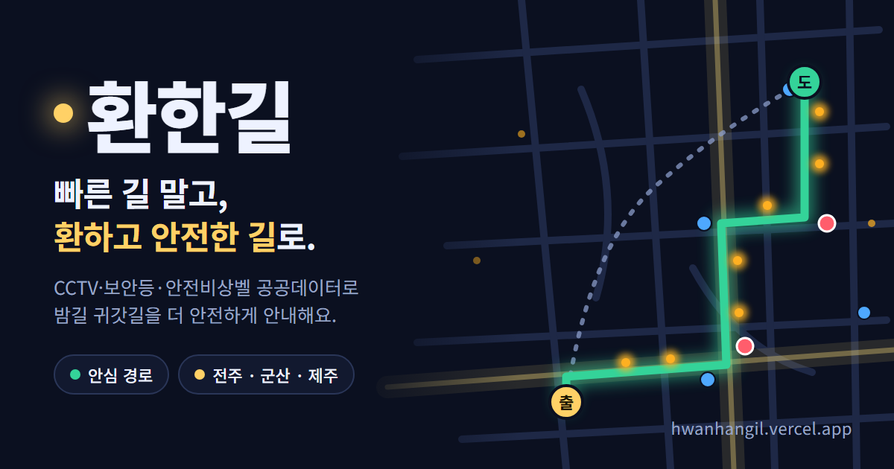
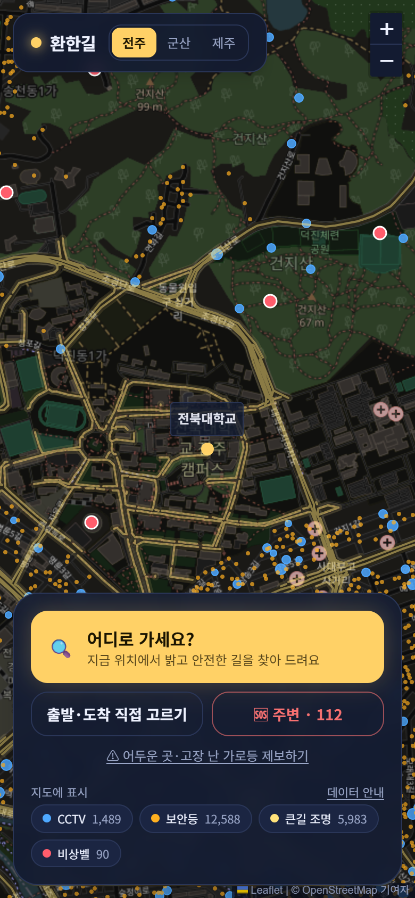
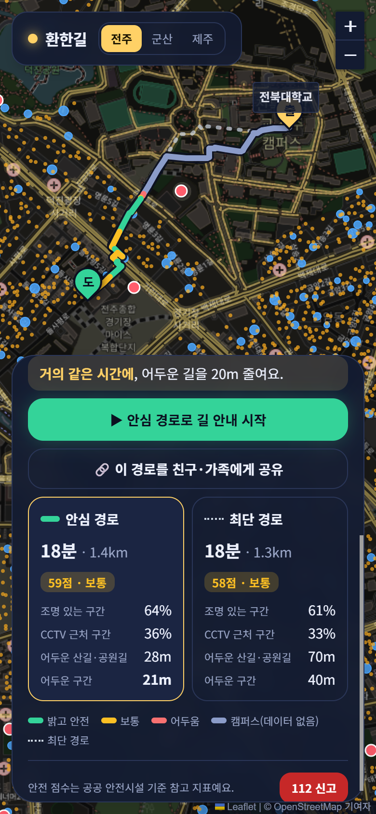
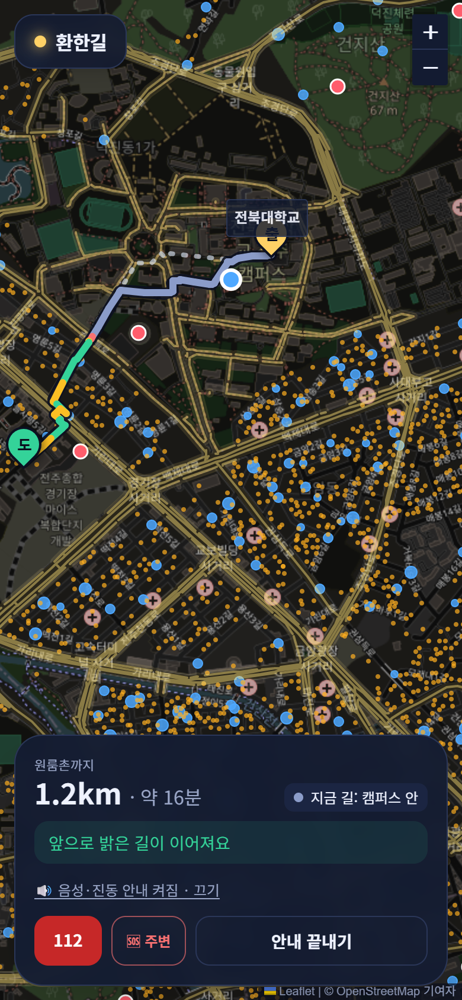
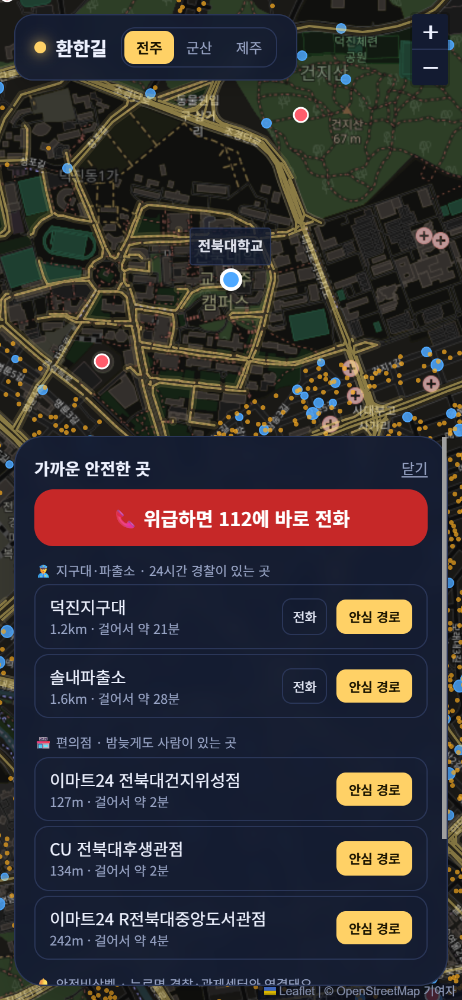
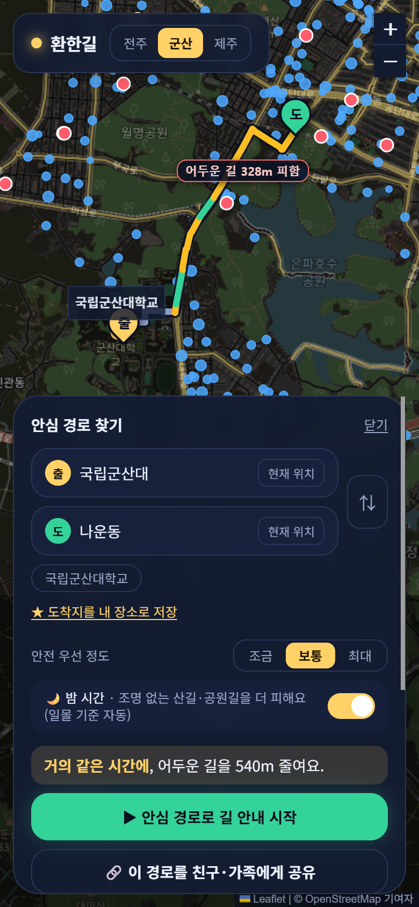
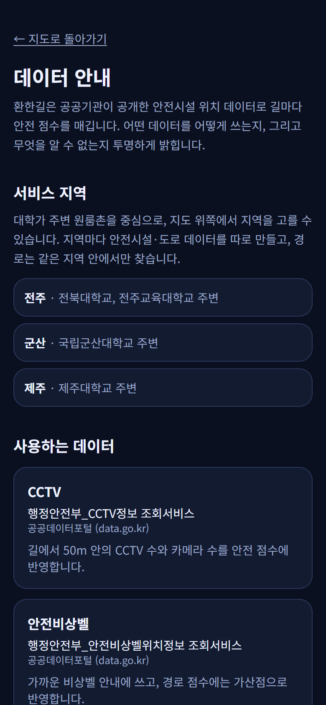

# 환한길 · 공모전 신청서 작성용 정리

> 2026학년도 AI 활용 역량강화 프로그램 · AI 바이브 코딩 챌린지 (마감 12/6)
> **신청서 항목 순서와 이름 그대로** 정리했습니다. 각 칸의 `▶ 붙여 넣을 내용` 아래 글을 신청서에 옮기면 됩니다.
> 숫자는 2026-11-26 실제 사이트 기준입니다. 자세한 근거는 [개발기록.md](개발기록.md), [작업일지.md](작업일지.md)에 있습니다.
> ⚠ **"본인의 판단"과 표현은 신청자 본인이 읽고 자기 말로 다듬어 주세요.**

---

## 1. 작품 썸네일

※ 주요 화면 또는 대표 이미지를 삽입

| 추천 | 파일 | 설명 |
|---|---|---|
| **대표 이미지 (가로형)** | [docs/screenshots/00-thumbnail.png](docs/screenshots/00-thumbnail.png) | 1200×630, 서비스 이름·한 줄 소개·안심 경로 그림. 카카오톡 미리보기와 같은 그림 |
| 주요 화면 (세로형) | [docs/screenshots/02-route.png](docs/screenshots/02-route.png) | 안심 경로와 최단 경로 비교 화면 |

---

## 2. 작품 소개

※ 대상 사용자, 해결 문제, 핵심 기능을 간략히 작성

▶ 붙여 넣을 내용

> **환한길 — 빠른 길 말고, 환하고 안전한 길로.**
>
> **대상 사용자**: 밤늦게 원룸·자취방으로 걸어서 귀가하는 대학생과 그 가족 (현재 전북대·전주교대, 국립군산대, 제주대 주변)
>
> **해결 문제**: 지도 앱 길찾기는 가장 빠른 길만 알려 줘서, 지름길이 어두운 골목이나 산책로여도 알 수 없습니다. 안심귀갓길·비상벨 정보는 흩어져 있어 "그래서 어느 길로 가야 하는지"에 답해 주지 않습니다.
>
> **핵심 기능**
> 1. **안심 경로 추천**: CCTV·보안등·안전비상벨 공공데이터로 모든 길에 안전 점수를 매겨, 최단 경로와 나란히 비교해 보여 줍니다.
> 2. **길 안내**: 걸어가는 동안 앞쪽 어두운 구간 예고, 경로 이탈·도착을 음성과 진동으로 알려 줍니다.
> 3. **가까운 안전한 곳**: 버튼 하나로 가장 가까운 비상벨·24시 편의점·지구대와 그곳까지의 안심 경로, 112 바로 걸기.
> 4. **집까지 한 번에·경로 공유·시민 제보**: 집을 저장해 한 번에 귀가 경로, 가족에게 경로 링크 공유, 고장 난 가로등 제보가 다른 사람의 경로에 반영.

---

## 3. 아이디어 창의성

※ 독창성, 기존 서비스와의 차별성, 새로운 접근방식을 작성

▶ 붙여 넣을 내용

> **① "안전"을 길 단위 숫자로 바꿨습니다.** 공공데이터의 시설 하나하나의 좌표로 모든 길(전주 기준 약 2만 5천 개 구간)에 0~100점 안전 점수를 매깁니다(CCTV 40%, 조명 35%, 도로 종류 20%, 비상벨 5%). 경로는 "거리 × (1 + 안전가중치 × 위험도)"로 계산해, **조금 돌아가더라도 밝은 길**을 고릅니다. 사용자는 안전 우선 정도(조금·보통·최대)를 고를 수 있습니다.
>
> **② 기존 서비스와의 차별점**
> - 지도 앱 길찾기: 빠른 길만 추천 → 환한길은 **최단 경로와 안심 경로를 나란히** 보여 주고 "거의 같은 시간에, 어두운 길을 540m 줄여요"(군산 실제 화면)처럼 무엇이 나아지는지 알려 줍니다.
> - 지자체 안심귀갓길·안전지도: 정보를 지도에 표시만 함 → 환한길은 **지금 내 출발지·도착지에 맞는 경로**로 바꿔 줍니다.
>
> **③ 새로운 접근**
> - **밤과 낮이 다른 경로**: 그날의 실제 일몰·일출 시각을 계산해, 해가 지면 조명 없는 산길·공원길을 더 강하게 피합니다(실험: 어두운 산길 61% 감소, 거리는 1.5%만 증가).
> - **시민 제보가 경로를 바꿉니다**: "가로등 고장·매우 어두움·공사 중" 제보가 14일 동안 다른 사람의 안심 경로에 반영되어, 몇 달 늦는 공공데이터의 빈틈을 메웁니다.
> - **낙인 없는 안전 점수**: 범죄 통계를 쓰지 않고 "안전시설이 있는 곳"을 기준으로 점수를 매겨, 특정 동네를 위험 지역으로 낙인찍지 않습니다.

---

## 4. 문제해결 및 실용성

※ 문제의 명확성, 사용자 필요와의 연관성, 실제 활용 가능성을 작성

▶ 붙여 넣을 내용

> **문제의 명확성**: 대학가 원룸촌은 골목이 많고, 캠퍼스와 주거지 사이에 공원·산책로가 끼어 있어 지름길이 어두운 경우가 많습니다. 실제 데이터로 확인한 결과 전북대 주변 최단 경로의 약 10%가 보안등·CCTV가 없는 어두운 구간이었습니다.
>
> **사용자 필요와의 연관성**: 밤길에서 실제로 필요한 순간에 맞춰 기능을 만들었습니다.
> | 상황 | 기능 |
> |---|---|
> | 집에 갈 때 | 🏠 집까지 버튼 한 번 (출발: 현재 위치, 도착: 저장한 집, 로그인 없음) |
> | 걸어가는 중 | 길 안내 + 음성·진동 알림 (휴대폰을 주머니에 넣어도 됨), 화면 꺼짐 방지 |
> | 불안할 때 | 🆘 주변: 가까운 비상벨·편의점·지구대 + 112 바로 걸기 |
> | 가족에게 알릴 때 | 경로 공유 링크 (카카오톡 미리보기 포함) |
> | 인터넷이 약할 때 | 이미 받은 지역은 인터넷 없이도 지도·경로·비상벨 사용 |
>
> **실제 활용 가능성**
> - 앱 설치 없이 **웹 주소로 바로** 쓰고, 원하면 홈 화면에 추가(앱처럼 사용)할 수 있습니다.
> - 공공데이터와 무료 지도(OpenStreetMap)만 써서 **운영 비용이 거의 없고**, 다른 지역은 데이터 스크립트를 한 번 돌리면 추가됩니다(실제로 군산·제주를 이렇게 추가).
> - 로그인·위치 저장이 없어 개인정보 부담이 없습니다.

---

## 5. 서비스 구현 및 완성도

**접속 URL / 실행 방법**:
- 접속 URL: **https://hwanhangil.vercel.app** (휴대폰·PC 브라우저에서 바로 열림)
- 소스 코드: https://github.com/JeongMin80/ai-vibe-contest (공개)
- 실행 방법: 사이트 접속 → "출발·도착 직접 고르기" → 캠퍼스 바로가기 또는 지도 누르기 → 안심 경로 확인 → "안심 경로로 길 안내 시작"

※ 핵심 기능의 구현·작동 상태, UI/UX, 배포·접속 안정성과 테스트 결과를 작성

▶ 붙여 넣을 내용

> **핵심 기능 작동 상태**: 안심 경로 추천, 길 안내(음성·진동), 가까운 안전한 곳, 내 장소, 경로 공유, 시민 제보, 밤 모드, 3개 지역(전주·군산·제주)이 모두 실제 배포 사이트에서 작동합니다.
>
> | 지역 | CCTV | 보안등 | 비상벨 |
> |---|---|---|---|
> | 전주 | 1,489 | 12,588 | 90 |
> | 군산 | 772 | 3,911 | 49 |
> | 제주 | 195 | 1,947 | 61 |
>
> **UI/UX**: 밤에 쓰는 앱이라 어두운 화면에 밝은 길이 빛나 보이도록 디자인했습니다. 휴대폰 한 손 조작을 기준으로 아래쪽 패널에 버튼을 모았고, 첫 화면은 "어디로 가세요?" 하나로 시작합니다. 접근성 검사(글자 대비 WCAG 4.5:1, 누르는 영역 24px 이상, 버튼 이름)를 4개 화면에서 통과했고, 키보드·화면 낭독기로도 쓸 수 있습니다.
>
> **배포·접속 안정성**: Vercel(웹)과 Supabase 서울 리전(제보 저장)에 배포했고, GitHub에 올리면 자동 배포됩니다. 경로 계산은 서버가 아니라 **사용자 휴대폰 안에서** 하므로 사용자가 늘어도 서버 부담이 없습니다. 도로 데이터는 직접 만든 형식으로 압축(1.4MB → 전송 약 300KB)했고, 한 번 받은 데이터는 보관해 인터넷이 끊겨도 쓸 수 있습니다. 인터넷이 끊기면 안내를 띄우고, 다시 연결되면 자동으로 다시 받습니다.
>
> **테스트 결과**: 자동 점검 8종(경로 계산, 내 장소, 길 안내 이탈·도착, 공유 링크 입력 검증, 밤 모드, 제보 반영, 지역 데이터, 음성 안내)을 기능을 바꿀 때마다 모두 통과한 뒤에만 배포했습니다. 매번 실제 사이트를 휴대폰 크기와 PC 크기로 직접 조작해 다시 확인했습니다.

---

## 6. AI 활용 및 개발 과정

**사용 AI 도구**: Claude Code (Anthropic, Claude Opus 모델) — 기획 조사, 공공데이터 분석, 코드 작성, 테스트, 배포, 개발 기록까지 사용

※ 대표 프롬프트, 반복 수정·개선, 오류 해결, AI 제안에 대한 본인의 판단을 작성

▶ 붙여 넣을 내용

> **■ 대표 프롬프트** (실제로 입력한 문장)
> 1. 주제 정하기: *"나중에 내가 공기업에 취직할때 자소서에 쓸수 있나? 그러면 그런 느낌으로 가도 괜찮을거 같은데"* → *"공공 데이터나 뭐 이런것을 이용해서 할수 있는것은 없나?"*
> 2. 데이터 검증 요구: *"데이터 먼저 확인"*
> 3. 개발 시작: *"응 시작해. 그리고 이제 내 주제는 밤길 안심 경로니까 이걸로 기능정의서나 뭐 이런것들도 다 바꿔줘. 자 가보자. 완벽하게 하는거야"*
> 4. 직접 써 보고 개선 요청: *"지금 가로등이나 보안등에 대한게 반영이 안됀거 아닌까? 내가 생각하기에 차도쪽은 밝아서 괜찮다 뭐 이런식으로 생각을 했어."*
> 5. 자동 개발 루프 (반복 실행한 지시문): *"(1) 사용량 확인 … (2) 개선목록.md에서 맨 위의 미완료 항목 하나를 골라 … (3) 구현 (4) 검증: npm test, npm run lint, npm run build, 브라우저 미리보기로 데스크톱·휴대폰(375x812) 화면 직접 확인. 실패하면 고치고 다시 검증, 통과 전에는 커밋하지 마. (5) 통과하면 main에 커밋하고 push → 실제 사이트에서 다시 확인 (6) 개발기록.md에 과정·문제·판단을 적고 … 비밀 키는 절대 커밋하거나 출력하지 마."*
>
> **■ 반복 수정·개선**: 위 루프로 **16번** 반복하며 기능을 하나씩 추가했습니다(장소 검색 → 내 장소 → 길 안내 → 주변 안전한 곳 → 로딩 속도 → 경로 공유 → 앱 설치 → 밤 모드 → 시민 제보 → 지역 확장 → 접근성 점검 → 공유 미리보기 → 음성 안내 → 오류 대비 → 제출 정리). 모든 과정은 개발기록.md(과정·문제·판단)와 작업일지.md(한 일·검증·커밋)에 남겼습니다.
>
> **■ 오류 해결** (AI가 처음에 틀렸다가 검증으로 바로잡은 사례)
> | 처음 가정 | 검증으로 발견 | 해결 |
> |---|---|---|
> | CCTV API가 한 번에 1,000개를 준다 | 실제 최대 100개라 데이터가 빠짐 | 페이지를 나눠 모두 받음 |
> | 전주시 보안등 API는 승인만 받으면 된다 | 활용가이드를 읽어 보니 전주시 자체 15자 키가 필요 | 행정안전부 전국 표준데이터로 바꿔 21,207개 확보 |
> | 조명 데이터 없이도 점수가 의미 있다 | 실제 보안등을 넣자 "어두운 길"이 41% → 10% | 추측으로 위험을 부풀리지 않도록 가중치 재실험 |
> | 도착지에 서면 도착 알림이 뜬다 | 시험해 보니 길에서 48m 떨어진 집은 도착이 안 뜸 | 원래 고른 지점 기준으로도 도착 판단 |
> | 결과 문장 "어두운 길을 Nm 줄여요"는 항상 맞다 | 시연 연습 중 "0m 줄여요"가 나옴 | 실제로 나아진 점(CCTV·조명 등)을 골라 말하도록 수정 |
>
> **■ AI 제안에 대한 본인의 판단**
> - **주제를 여러 번 바꿨습니다.** AI가 처음 제안한 주제들(팀플 기여도, 냉장고 관리 등)은 마음에 들지 않아 보류했고, 공기업 취업을 염두에 두고 **공공데이터를 활용한 공공 가치 주제**로 방향을 직접 정했습니다.
> - **"대학가 월세 진단"을 중단했습니다.** AI가 데이터를 확인한 결과 실거래가가 법정동 단위로만 공개됐고, 동 하나의 범위가 생각보다 넓어 정확한 판정이 어렵다고 판단해 접었습니다.
> - **"데이터 먼저 확인"을 요구했습니다.** 아이디어만 보고 정하지 않고, 데이터를 실제로 받아 본 뒤 "밤길 안심 경로"를 확정했습니다.
> - **AI가 놓친 부분을 직접 써 보고 짚었습니다.** 첫 버전을 써 보니 가로등이 반영되지 않았고, "차도 쪽은 가로등이 있어 밝다"는 생활 경험을 알려 줬습니다. 이 의견으로 큰길을 "조명 있음"으로 추정하는 규칙이 생겼고, 추정이라는 사실은 데이터 안내 페이지에 공개하도록 했습니다.
> - **AI에게 일을 맡기는 규칙을 직접 정했습니다.** "검증 통과 전에는 커밋하지 말 것", "비밀 키는 절대 커밋·출력하지 말 것", "주간 사용량 60%까지만"처럼 AI가 지켜야 할 기준을 정해 두고 자동 개발을 맡겼습니다.

---

## 7. 증빙자료

**시연 영상 / 화면 캡처 / 프롬프트·개선 기록 링크**:

▶ 붙여 넣을 내용

> - **시연 영상**: (녹화 후 링크 입력 — 아래 "시연 순서" 참고)
> - **화면 캡처**: https://github.com/JeongMin80/ai-vibe-contest/tree/main/docs/screenshots
> - **프롬프트·개선 기록**
>   - 개발 과정(과정·문제·판단): https://github.com/JeongMin80/ai-vibe-contest/blob/main/개발기록.md
>   - 루프별 작업 일지(한 일·검증·커밋): https://github.com/JeongMin80/ai-vibe-contest/blob/main/작업일지.md
>   - 개선 목록(사용자 의견 포함): https://github.com/JeongMin80/ai-vibe-contest/blob/main/개선목록.md
>   - 전체 변경 이력(커밋): https://github.com/JeongMin80/ai-vibe-contest/commits/main

**화면 캡처 6장** (휴대폰 화면, 780×1688): `node scripts/make-screens.mjs` 로 실제 사이트에서 다시 만들 수 있습니다.

| 1. 첫 화면 | 2. 안심 경로 결과 | 3. 길 안내 |
|---|---|---|
|  |  |  |
| **4. 가까운 안전한 곳** | **5. 군산 지역** | **6. 데이터 안내** |
|  |  |  |

---

## 부록 A. 시연 영상 녹화 순서 (약 3분)

휴대폰 화면 녹화로 진행합니다. 실제 위치 대신 지도를 눌러 고르면 어디서든 시연할 수 있습니다.

| 시간 | 할 일 | 보여 줄 점 |
|---|---|---|
| 0:00 | https://hwanhangil.vercel.app 열기 | 어두운 지도 위 CCTV(파랑)·보안등(주황)·큰길 조명(노란 빛줄기)·비상벨(빨강) |
| 0:20 | **출발·도착 직접 고르기** → 캠퍼스 바로가기 "전북대학교" → 지도에서 남서쪽 원룸촌 누르기 | 초록 **안심 경로**와 점선 **최단 경로**를 나란히, 무엇이 나아지는지 한 줄 요약 |
| 0:50 | 안전 우선 **조금 / 보통 / 최대** 바꿔 보기, 🌙 밤 시간 끄고 켜기 | 경로가 바뀌는 것 |
| 1:20 | **안심 경로로 길 안내 시작** | 남은 거리, 지금 길 안전 정도, 어두운 길 예고, 🔊 음성 안내 |
| 1:50 | 안내 끝내기 → **🆘 주변 · 112** | 가까운 비상벨·편의점·지구대, 그곳까지 안심 경로 |
| 2:20 | **이 경로를 친구·가족에게 공유** | 카카오톡 미리보기(그림·제목) |
| 2:40 | 위쪽 **군산 / 제주** 누르기, **데이터 안내** 열기 | 지역 확장, 데이터 출처와 한계를 숨기지 않는 점 |

## 부록 B. 한계와 다음 단계 (신청서에 넣을 칸이 있으면 활용)

- **가로등 실제 위치**: 전주시 가로등 API는 전주시 자체 키가 필요해 아직 쓰지 못했습니다. 지금은 큰길 추정이며, 키를 받으면 실제 위치로 바꿉니다.
- **캠퍼스 안 CCTV**: 대학이 자체 관리해 공개되지 않습니다. 대학과 협력하면 점수가 정확해집니다.
- **제주 CCTV**: 공개 데이터가 약 200곳뿐이라 점수가 낮게 나올 수 있습니다.

## 부록 C. 제출 전에 직접 할 일 (체크리스트)

- [ ] 휴대폰으로 실제 위치로 길 안내를 한 번 시작해 보기 (위치 권한 허용, 음성이 나오는지)
- [ ] 카카오톡 "나와의 채팅"에 주소를 보내 미리보기 그림이 나오는지
- [ ] 시민 제보를 실제로 한 번 보내 보기 (지도에 14일 동안 보입니다)
- [ ] **시연 영상 녹화** (부록 A 순서) → 유튜브 "일부 공개" 등으로 올려 7번 칸에 링크
- [ ] **6번 "본인의 판단"을 읽고 자기 말로 다듬기**
- [ ] 신청서(HWP)에 1~7번 내용 옮기기, 썸네일·화면 캡처 붙이기
- [ ] **7번 링크가 열리는지 제출 직전에 확인**: 2026-11-26 밤에 GitHub가 잠시 일부 페이지에서 오류(503)를 냈다가 몇 분 뒤 정상으로 돌아왔습니다. 혹시 안 열리면 주소의 `blob`을 `raw`로 바꾼 원문 링크를 쓰면 됩니다
- [x] GitHub 저장소 공개 여부: 2026-11-26 확인 결과 **공개(Public)** 상태 (로그인 없이 열림)
